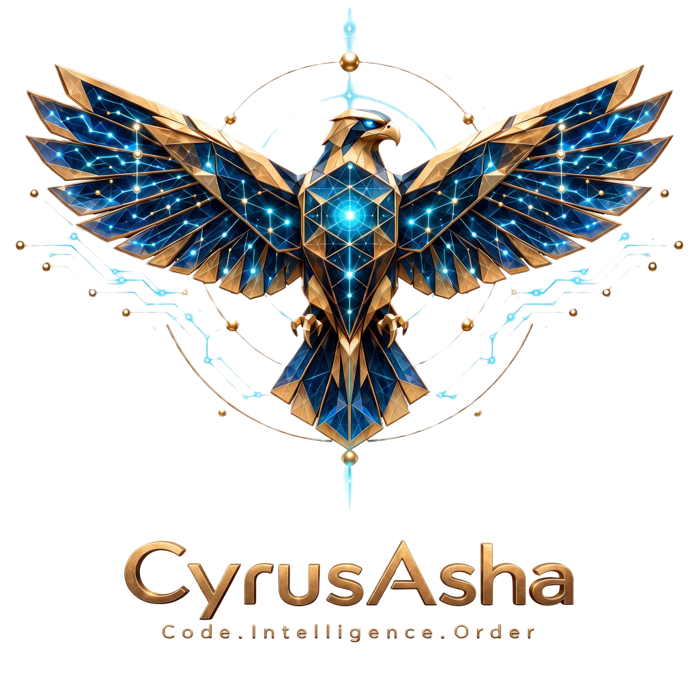

<div align="center">
  
</div>

# 🚀 Global AI Agent Configurator for Windows (v1.1.0 - Enterprise Edition)

[](https://microsoft.com/windows)
[](https://microsoft.com/powershell)
[](https://opensource.org/licenses/MIT)
[]()
[]()

---

یک اسکریپت جامع، خودکار و یکپارچه **PowerShell (نسخه ۱.۱.۰ - Enterprise Edition)** برای ساخت و پیکربندی پوشه مرجع مرکزی `C:\Users\<Username>\.agents` در ویندوز.

این پروژه تمامی **اسکیل‌ها (Skills)**، **سرورهای MCP**، **قوانین خودکار (Rules)**، **دستورات اسلش (Slash Commands)**، **هوک‌ها (Hooks)** و **ایجنت‌های تخصصی (Sub-Agents)** را از **۳۹ مخزن برتر متن‌باز دنیا** یک‌جا دانلود و تنظیم کرده و از طریق **لینک پوشه (Junction / Symbolic Link)** به بیش از ۲۰ ایجنت هوش مصنوعی روی سیستم شما متصل می‌کند.

---

## English

### 🎯 What problem this solves

If you use multiple AI coding agents and development environments simultaneously (such as **Cursor, Claude Code, OpenCode, Antigravity, Copilot, Hermes, Freebuff, Codex, Gemini, Windsurf, Cline**, and more), you would otherwise have to copy and configure rules, skills, and MCP servers separately for each one.

By running this script:

1. **Single Source of Truth:** The folder `C:\Users\<Username>\.agents` becomes the only reference for managing your AI agents.
2. **Instant sync via Junction / Symbolic Link:** When you add or edit any skill, rule, or MCP server in `.agents`, all connected agents recognize it immediately without re-copying.
3. **Full autonomous orchestration (`00-auto-orchestrator.md`):** Agents automatically load skills and relevant personas from the central folder before answering any question.
4. **Non-destructive:** No file is deleted or fully overwritten. Only the clearly marked block between two comment markers is updated; your content remains untouched.

---

## فارسی

### 🎯 مشکل اینکه این اسکریپت چه حل می‌کند؟

اگر هم‌زمان از چندین ایجنت و محیط کدنویسی هوش مصنوعی (مانند **Cursor, Claude Code, OpenCode, Antigravity, Copilot, Hermes, Freebuff, Codex, Gemini, Windsurf, Cline** و ...) استفاده می‌کنید، مجبور خواهید بود برای هر کدام به صورت جداگانه قوانین (Rules)، مهارت‌ها (Skills) و سرورهای MCP را کپی و پیکربندی کنید.

با اجرای این اسکریپت:

1. **مدیریت از یک نقطه مرکزی (Single Source of Truth):** پوشه `C:\Users\<Username>\.agents` تبدیل به تنها مرجع مدیریت ایجنت‌های شما می‌شود.
2. **همگام‌سازی آنی با Junction / Symlink:** با اضافه کردن یا ویرایش هر اسکیل، قاعده یا سرور MCP در پوشه `.agents`، تمام ایجنت‌ها بلافاصله و بدون نیاز به کپی مجدد آن را شناسایی می‌کنند.
3. **ارکستراسیون کاملاً خودکار (`00-auto-orchestrator.md`):** ایجنت‌ها قبل از پاسخ به هر سوالی، به صورت خودکار مهارت‌ها و شخصیت مرتبط را از پوشه مرکزی بارگذاری می‌کنند.
4. **غیرمخرب بودن:** هیچ فایلی پاک یا بازنویسی کامل نمی‌شود. فقط بلوک مشخص‌شده بین دو مارکر کامنتی آپدیت می‌شود و محتوای شما دست‌نخورده می‌ماند.

---

## 🔄 Resource Collection & Linking Architecture / architektور جمع‌آوری و لینک‌سازی منابع

### How it works / چگونه کار می‌کند

When you run `CyrusAsha_GlobalAgents.ps1`, the script performs a **two-phase collection and linking** process:

**Phase 1 — Collect (گام ۱ — جمع‌آوری):**
The script scans all known AI agent home directories on your system (Freebuff, Codebuff, Claude Code, Cursor, Codex, Gemini CLI, Windsurf, Cline, Roo Code, Continue.dev, Trae, Junie, Amazon Q, Hermes, OpenCode, Antigravity, Copilot, and more). It copies all `skills/`, `rules/`, `agents/`, `commands/`, `hooks/`, `mcp.json`, and instruction files (`knowledge.md`, `AGENTS.md`, `CLAUDE.md`, `GEMINI.md`, `CODEX.md`) from each agent's home into the central **`%USERPROFILE%\.agents\`** folder.

**Phase 2 — Link (گام ۲ — لینک‌سازی):**
The script then creates **Junction / Symbolic Link** connections from each agent's home subfolders back to the central `.agents\` subfolders. For example:
- `C:\Users\<Username>\.cursor\skills` → `C:\Users\<Username>\.agents\skills`
- `C:\Users\<Username>\.claude\rules` → `C:\Users\<Username>\.agents\rules`
- `C:\Users\<Username>\.codex\agents` → `C:\Users\<Username>\.agents\agents`

This means **every skill installed once in `.agents\skills\` is instantly available to all 20+ supported agents** — no duplicate copying, no configuration drift.

**When you install a new skill / When a new SKILL.md appears:**
1. Drop the skill folder into `%USERPROFILE%\.agents\skills\` (or let the script sync it from GitHub)
2. All connected agents see it immediately through their linked `skills` folder
3. Run `/CyrusAsha_Skills` in any agent chat to load and use it

---

## فارسی

### چگونه کار می‌کند / How it works

هنگامی که اسکریپت `CyrusAsha_GlobalAgents.ps1` اجرا می‌شود، فرآیند **دوگانه جمع‌آوری و لینک‌سازی** انجام می‌شود:

**گام ۱ — جمع‌آوری (Collect):**
اسکریپت تمامی پوشه‌های خانگی ایجنت‌های هوش مصنوعی شناخته‌شده روی سیستم شما (Freebuff, Codebuff, Claude Code, Cursor, Codex, Gemini CLI, Windsurf, Cline, Roo Code, Continue.dev, Trae, Junie, Amazon Q, Hermes, OpenCode, Antigravity, Copilot, Free-Pi CLI و ...) را اسکن می‌کند و تمامی محتویات پوشه‌های `skills/`, `rules/`, `agents/`, `commands/`, `hooks/`, `mcp.json` و فایل‌های راهنما (`knowledge.md`, `AGENTS.md`, `CLAUDE.md`, `GEMINI.md`, `CODEX.md`) را از هر یک از خانه‌های ایجنت‌ها کپی می‌کند و در پوشه مرکزی **`%USERPROFILE%\.agents\`** قرار می‌دهد.

**گام ۲ — لینک‌سازی (Link):**
اسکریپت سپس اتصال‌های **Junction / Symbolic Link** را از زیرپوشه‌های خانه هر ایجنت به زیرپوشه‌های مربوطه در `.agents\` ایجاد می‌کند. به عنوان مثال:
- `C:\Users\<Username>\.cursor\skills` → `C:\Users\<Username>\.agents\skills`
- `C:\Users\<Username>\.claude\rules` → `C:\Users\<Username>\.agents\rules`
- `C:\Users\<Username>\.codex\agents` → `C:\Users\<Username>\.agents\agents`
- `C:\Users\<Username>\.free-pi\skills` → `C:\Users\<Username>\.agents\skills`

این بدان معناست که **هر اسکیل یکبار در `.agents\skills\` نصب شود، برای کلیه ۲۰+ ایجنت پشتیبانی‌شده در لحظه در دسترس است** — بدون کپی تکراری، بدون اختلاف پیکربندی.

**وقتی یک اسکیل جدید نصب می‌شود / When a new SKILL.md appears:**
1. پوشه اسکیل را در `%USERPROFILE%\.agents\skills\` قرار دهید (یا از طریق سینک گیت‌هاب اسکریپت به آن دسترسی پیدا کند)
2. کلیه ایجنت‌های متصل بلافاصله از طریق پوشه `skills` لینک‌شده خود آن را می‌بینند
3. دستور `/CyrusAsha_Skills` را در چت هر ایجنت اجرا کنید تا اسکیل بارگذاری و استفاده شود.

---

| AI Agent / IDE | Connection Path on Windows | Support Status |
|:---|:---|:---:|
| Hermes Agent | `C:\Users\<Username>\.hermes` | ✅ Full |
| OpenCode | `C:\Users\<Username>\.config\opencode` | ✅ Full |
| Antigravity | `C:\Users\<Username>\.antigravity` & `.gemini\antigravity` | ✅ Full |
| Free-Pi CLI *(جدید)* | `C:\Users\<Username>\.free-pi` & `.free-pi\agent` | ✅ Full |
| VS Copilot | `C:\Users\<Username>\.copilot` | ✅ Full |
| Freebuff / Codebuff | `C:\Users\<Username>\.freebuff` and `%APPDATA%\freebuff` | ✅ Full |
| Claude Code | `C:\Users\<Username>\.claude` | ✅ Full |
| Cursor | `C:\Users\<Username>\.cursor` | ✅ Full |
| OpenAI Codex CLI | `C:\Users\<Username>\.codex` | ✅ Full |
| Google Gemini CLI | `C:\Users\<Username>\.gemini` | ✅ Full |
| Windsurf | `C:\Users\<Username>\.windsurf` | ✅ Full |
| Cline (VS Code) | `C:\Users\<Username>\.cline` | ✅ Full |
| Roo Code (VS Code) | `C:\Users\<Username>\.roo` | ✅ Full |
| Continue.dev | `C:\Users\<Username>\.continue` | ✅ Full |
| Trae | `C:\Users\<Username>\.trae` | ✅ Full |
| JetBrains Junie | `C:\Users\<Username>\.junie` | ✅ Full |
| Amazon Q Developer | `C:\Users\<Username>\.amazonq` | ✅ Full |
| Goose | `C:\Users\<Username>\.goose` | ✅ Full |
| Aider | `C:\Users\<Username>\.aider` | ✅ Full |
| Codeium | `%APPDATA%\Codeium\Windsurf` | ✅ Full |

| ایجنت / IDE | مسیر اتصال در ویندوز | وضعیت پشتیبانی |
|:---|:---|:---:|
| **Hermes Agent** | `C:\Users\<Username>\.hermes` | ✅ کامل |
| **OpenCode** | `C:\Users\<Username>\.config\opencode` | ✅ کامل |
| **Antigravity** | `C:\Users\<Username>\.antigravity` و `.gemini\antigravity` | ✅ کامل |
| **Free-Pi CLI** *(جدید)* | `C:\Users\<Username>\.free-pi` و `.free-pi\agent` | ✅ کامل |
| **VS Copilot** | `C:\Users\<Username>\.copilot` | ✅ کامل |
| **Freebuff / Codebuff** | `C:\Users\<Username>\.freebuff` و `%APPDATA%\freebuff` | ✅ کامل |
| **Claude Code** | `C:\Users\<Username>\.claude` | ✅ کامل |
| **Cursor** | `C:\Users\<Username>\.cursor` | ✅ کامل |
| **OpenAI Codex CLI** | `C:\Users\<Username>\.codex` | ✅ کامل |
| **Google Gemini CLI** | `C:\Users\<Username>\.gemini` | ✅ کامل |
| **Windsurf** | `C:\Users\<Username>\.windsurf` | ✅ کامل |
| **Cline (VS Code)** | `C:\Users\<Username>\.cline` | ✅ کامل |
| **Roo Code (VS Code)** | `C:\Users\<Username>\.roo` | ✅ کامل |
| **Continue.dev** | `C:\Users\<Username>\.continue` | ✅ کامل |
| **Trae** | `C:\Users\<Username>\.trae` | ✅ کامل |
| **JetBrains Junie** | `C:\Users\<Username>\.junie` | ✅ کامل |
| **Amazon Q Developer** | `C:\Users\<Username>\.amazonq` | ✅ کامل |
| **Goose** | `C:\Users\<Username>\.goose` | ✅ کامل |
| **Aider** | `C:\Users\<Username>\.aider` | ✅ کامل |
| **Codeium** | `%APPDATA%\Codeium\Windsurf` | ✅ کامل |

---

## 📦 Integrated Repositories (39 Open-Source Tools) / فهرست ۳۹ مخزن ادغام‌شده

The script automatically clones (or updates via `git pull` on subsequent runs) the following 39 repositories and places their contents into the central `.agents` folder:

این اسکریپت در هنگام اجرا، ۳۹ مخزن زیر را به صورت خودکار کلون (یا در اجراهای بعدی `git pull` و آپدیت) کرده و محتوای آن‌ها را در پوشه مرکزی `.agents` جای‌گذاری می‌کند:

### 🧩 Frameworks, Harnesses & Multi-Agent Systems / فریم‌ورک‌ها، هارنس‌ها و سیستم‌های چند-ایجنتی

| Repository | GitHub | Description / کاربرد |
|:---|:---|:---|
| `everything-claude-code` | [WorldFlowAI/everything-claude-code](https://github.com/WorldFlowAI/everything-claude-code.git) | Comprehensive toolkit including specialized agents, slash commands, skills, rules, and automation hooks. |
| `ruflo` | [ruvnet/ruflo](https://github.com/ruvnet/ruflo.git) | Harness framework for agent swarms, adaptive memory, and intelligent model routing. |
| `agency-agents` | [msitarzewski/agency-agents](https://github.com/msitarzewski/agency-agents.git) | Complete collection of specialized agents (frontend architect, backend, project manager, security, marketing, ...). |
| `deer-flow` | [bytedance/deer-flow](https://github.com/bytedance/deer-flow.git) | Super-agent and harness framework by ByteDance for deep research, coding, and automation. |
| `ECC` *(جدید)* | [affaan-m/ECC](https://github.com/affaan-m/ECC.git) | Agent harness performance optimization system, memory, instincts, and research-first workflows. |
| `awesome-harness-engineering` | [yenanjing/awesome-harness-engineering](https://github.com/yenanjing/awesome-harness-engineering.git) | Directory and reference for harness engineering, architecture patterns, and agent evaluation. |

### 🛠️ Software Engineering, Coding & QA / مهندسی نرم‌افزار، کدنویسی، تست و تضمین کیفیت

| Repository | GitHub | Description / کاربرد |
|:---|:---|:---|
| `claude-skills` *(جدید)* | [Jeffallan/claude-skills](https://github.com/Jeffallan/claude-skills.git) | 67 specialized full-stack engineering skills with progressive disclosure architecture saving 50% tokens. |
| `agent-skills` *(جدید)* | [addyosmani/agent-skills](https://github.com/addyosmani/agent-skills.git) | Production-grade software engineering lifecycle skills (Plan, Build, Verify, Review) by Addy Osmani. |
| `qa-skills` *(جدید)* | [petrkindlmann/qa-skills](https://github.com/petrkindlmann/qa-skills.git) | 50+ enterprise QA and automated testing skills (Playwright, Cypress, Unit, Chaos, Performance). |
| `ponytail` *(جدید)* | [DietrichGebert/ponytail](https://github.com/DietrichGebert/ponytail.git) | Senior developer minimalism mindset: anti-bloat, native stdlib preference, zero-unnecessary-code. |
| `one-skill-to-rule-them-all` *(جدید)* | [rebelytics/one-skill-to-rule-them-all](https://github.com/rebelytics/one-skill-to-rule-them-all.git) | Autonomous task observer meta-skill that analyzes sessions, captures friction, and evolves skills. |
| `superpowers` *(جدید)* | [obra/superpowers](https://github.com/obra/superpowers.git) | Agentic skills framework with TDD methodology, isolated Git worktrees, and parallel review agents. |

### 🔒 Cybersecurity & Pentesting / امنیت سایبری، ممیزی و مهندسی معکوس

| Repository | GitHub | Description / کاربرد |
|:---|:---|:---|
| `Anthropic-Cybersecurity-Skills` | [mukul975/Anthropic-Cybersecurity-Skills](https://github.com/mukul975/Anthropic-Cybersecurity-Skills.git) | 817+ structured security skills based on MITRE ATT&CK, NIST CSF 2.0, and D3FEND. |
| `security-audit-skill` *(جدید)* | [cloudflare/security-audit-skill](https://github.com/cloudflare/security-audit-skill.git) | Multi-phase source code security audit skill with machine-readable findings and independent validation. |
| `strix` | [usestrix/strix](https://github.com/usestrix/strix.git) | AI Pentester intelligent agent for discovering code, web, and API vulnerabilities with PoC generation. |
| `rea` *(جدید)* | [morluto/rea](https://github.com/morluto/rea.git) | Reverse-engineer application behavior and native binaries without original source code. |

### 🔍 SEO, AEO & AI Engine Optimization / سئو، AEO و بهینه‌سازی موتورهای هوش مصنوعی

| Repository | GitHub | Description / کاربرد |
|:---|:---|:---|
| `Claude-Code-SEO-skills` | [VibeWithClaude/Claude-Code-SEO-skills](https://github.com/VibeWithClaude/Claude-Code-SEO-skills.git) | Collection of specialized skills and sub-agents for complete SEO, schema, sitemap, and content optimization. |
| `claude-seo` | [AgriciDaniel/claude-seo](https://github.com/AgriciDaniel/claude-seo.git) | Comprehensive package of 26 sub-skills and 19 sub-agents for technical SEO, E-E-A-T, backlink analysis, llms.txt, and reporting. |
| `geo-optimizer-skill` | [Auriti-Labs/geo-optimizer-skill](https://github.com/Auriti-Labs/geo-optimizer-skill.git) | Website optimization for citation in AI answer engines (ChatGPT, Perplexity, Gemini, AI Overviews). |
| `open-seo` *(جدید)* | [every-app/open-seo](https://github.com/every-app/open-seo.git) | Open-source, serverless alternative to Ahrefs and Semrush integrated via MCP. |

### 🎨 Design, UI/UX & 3D / طراحی رابط کاربری، فرانت‌اند و گرافیک

| Repository | GitHub | Description / کاربرد |
|:---|:---|:---|
| `taste-skill` | [Leonxlnx/taste-skill](https://github.com/Leonxlnx/taste-skill.git) | Enhances agent design taste, art direction selection, credible images, and visual browser testing. |
| `ui-ux-pro-max-skill` | [nextlevelbuilder/ui-ux-pro-max-skill](https://github.com/nextlevelbuilder/ui-ux-pro-max-skill.git) | UI/UX knowledge base including 79 styles, 192 product types, color palettes, and standard typography. |
| `tastecode` | [vishalx0707/tastecode](https://github.com/vishalx0707/tastecode.git) | Frontend coding quality improvement layer and adherence to aesthetic principles in components. |
| `skills-emilkowalski` | [emilkowalski/skills](https://github.com/emilkowalski/skills.git) | Specialized skills for smooth web animations, React Native/Expo, Swift, and Apple design principles. |
| `diagram-design` | [cathrynlavery/diagram-design](https://github.com/cathrynlavery/diagram-design.git) | Professional architecture diagrams, flowcharts, and sequences in standalone HTML+SVG files. |
| `awesome-claude-design` | [VoltAgent/awesome-claude-design](https://github.com/VoltAgent/awesome-claude-design.git) | Ready-made design systems (`DESIGN.md`) for generating modern user interfaces with a single prompt. |
| `img2threejs` | [img2threejs/img2threejs](https://github.com/img2threejs/img2threejs.git) | Converts 2D reference images into interactive and animated 3D scenes and models with Three.js. |

### 🧠 Memory & Context Management / حافظه بلندمدت و مدیریت کانتکست

| Repository | GitHub | Description / کاربرد |
|:---|:---|:---|
| `Agent-Memory` | [Threesided-Studios/Agent-Memory](https://github.com/Threesided-Studios/Agent-Memory.git) | Persistent memory system combining keyword search, vector search, and knowledge graph for agents. |
| `OpenViking` | [volcengine/OpenViking](https://github.com/volcengine/OpenViking.git) | Self-completing context database for memory integration, RAG systems, and agent skills. |
| `mex` *(جدید)* | [mex-memory/mex](https://github.com/mex-memory/mex.git) | Git-native team & project memory shared across engineering teams and coding agents. |

### 🌐 Browser & Web Automation / اتوماسیون مرورگر، وب‌گردی و اسکرپینگ

| Repository | GitHub | Description / کاربرد |
|:---|:---|:---|
| `browser-use` | [browser-use/browser-use](https://github.com/browser-use/browser-use.git) | Powerful tool to give agents web browsing, clicking, form filling, and real page interaction capabilities. |
| `agent-reach` | [EdisonChenAI/agent-reach](https://github.com/EdisonChenAI/agent-reach.git) | Direct agent access to internet platforms (Twitter/X, YouTube, Reddit, GitHub, ...). |
| `Scrapegraph-ai` | [ScrapeGraphAI/Scrapegraph-ai](https://github.com/ScrapeGraphAI/Scrapegraph-ai.git) | Intelligent graph- and LLM-based scraping for extracting structured data from websites and documents. |

### 🏛️ Official Tech Ecosystems & Hardware Integration / اسکیل‌های رسمی اکوسیستم‌های فناوری

| Repository | GitHub | Description / کاربرد |
|:---|:---|:---|
| `skills-nvidia` *(جدید)* | [NVIDIA/skills](https://github.com/NVIDIA/skills.git) | Official NVIDIA skills for Physical AI, robotics, CUDA-X, simulation, and enterprise RAG. |
| `skills-huggingface` *(جدید)* | [huggingface/skills](https://github.com/huggingface/skills.git) | Deep Hugging Face integration: models, datasets, Spaces, and cloud training pipelines. |
| `skills-anthropic` *(جدید)* | [anthropics/skills](https://github.com/anthropics/skills.git) | Official public standard and foundational agent skills from Anthropic. |
| `awesome-copilot` *(جدید)* | [github/awesome-copilot](https://github.com/github/awesome-copilot.git) | Community-driven official collection of custom instructions, skills, and agents for GitHub Copilot. |
| `obsidian-skills` *(جدید)* | [kepano/obsidian-skills](https://github.com/kepano/obsidian-skills.git) | Official agent skills by Steph Ango (Kepano) for Obsidian vaults, CLI, and JSON Canvas. |

### 💻 Terminal Coding Agents / ایجنت‌های خط فرمان

| Repository | GitHub | Description / کاربرد |
|:---|:---|:---|
| `free-pi-cli` *(جدید)* | [dennisonbertram/free-pi-cli](https://github.com/dennisonbertram/free-pi-cli.git) | Free open terminal coding agent client with private context routing and zero ads in model prompt. |

---

## 🔌 MCP Servers Configured in `mcp.json` (7 Servers) / سرورهای MCP پیکربندی‌شده در `mcp.json` (۷ سرور)

The file `C:\Users\<Username>\.agents\mcp.json` is automatically created with the following 7 useful servers and linked to all agents:

فایل `C:\Users\<Username>\.agents\mcp.json` به صورت خودکار با ۷ سرور کاربردی زیر ساخته و به تمام ایجنت‌ها لینک می‌شود:

| # | MCP Server | Package / Command | Main Use / کاربرد اصلی |
|---|:---|:---|:---|
| 1 | GitHub | `@modelcontextprotocol/server-github` | Manage repositories, PRs, Issues, and read/write code on GitHub. |
| 2 | Filesystem | `@modelcontextprotocol/server-filesystem` | Direct and secure agent access to your project folders (`C:\Projects`). |
| 3 | Brave Search | `@modelcontextprotocol/server-brave-search` | Live and instant web search. |
| 4 | Supabase | `@supabase/mcp-server-supabase@latest` | Direct connection to Supabase database, table creation, SQL queries, and RLS configuration. |
| 5 | DuckDB | `@modelcontextprotocol/server-duckdb` | Fast data analysis and SQL queries on local database (`C:\Data\local_database.duckdb`). |
| 6 | Google Search Console | `@aminforou/mcp-gsc` | Real SEO data analysis, keywords, clicks, and impressions directly from agent chat. |
| 7 | Playwright | `@modelcontextprotocol/server-playwright` | Browser automation, End-to-End testing, and live UI inspection by the agent. |

> **Note:** The `mcp.json` file is created **only once** and your API tokens/keys are **never overwritten** on re-runs.

> **نکته:** فایل `mcp.json` فقط **یک‌بار** ساخته می‌شود و توکن‌ها/کلیدهای API شما هرگز بازنویسی نمی‌شوند.

---

## ⚡ Automatic Rules & Slash Commands / قوانین خودکار و دستورات اسلش

### 🧠 Global Rules (`~/.agents/rules/` / قوانین سرتاسری)

* **`00-auto-orchestrator.md`** (Autonomous Orchestration & Discovery Protocol): Named with `00-` prefix so it is always the first rule the agent reads. Its duty is to automatically check the `skills` folder, select a persona from `agents`, comply with rules, proactively use `mcp.json` tools, and manage context automatically (when context exceeds 75%) without manual user command.
* **`security-architect.md`** (Senior Security & Software Architecture Lead): Obliges the agent to inspect the code repository and audit or generate the 5 key security and governance files (`SECURITY.md`, `AGENTS.md`, `.env.example`, `THREAT-MODEL.md`, `SECURITY-CHECKLIST.md`).

### 📜 Slash Commands (`~/.agents/commands/` / دستورات اسلش)

You can use these 8 commands in the chat of any of your agents:

در محیط چت هر کدام از ایجنت‌های خود می‌توانید از این ۸ دستور استفاده کنید:

| Slash Command | Function / عملکرد |
|:---|:---|
| `/CyrusAsha_Auto` | **Fully autonomous pipeline:** Breaks goals into technical tasks, runs `/CyrusAsha_Agents`, `/CyrusAsha_Skills`, and `/CyrusAsha_Rules` logic in parallel, implements code, and performs security checks. |
| `/CyrusAsha_Skills` | Scans all `SKILL.md` files in `~/.agents/skills/`, matches against user prompt, and loads 1–3 primary skills (and up to 5 in multi-phase tasks based on each phase needs). |
| `/CyrusAsha_Rules` | Scans all rules in `~/.agents/rules/`, audits current codebase, and refactors code for 100% architecture compliance. |
| `/CyrusAsha_Agents` | Scans specialist personas in `~/.agents/agents/`, selects the best expert (e.g., database architect or frontend specialist), and delegates the task. |
| `/CyrusAsha_Audit-Security` | Performs a full security audit on the repository, provides a status table, and creates/completes the 5 standard files. |
| `/CyrusAsha_Compact` | Runs `pre-compact.ps1` hook, summarizes session state, saves checkpoint to `~/.agents/session-state.md`, and frees context window. |
| `/CyrusAsha_Hooks` | Scans, checks status, and manually tests lifecycle scripts in `~/.agents/hooks/`. |
| `/CyrusAsha_Commands` | Displays a cheat-sheet table of all available slash commands and suggests the best command for the current task. |

| دستور اسلش | عملکرد و کارایی دقیق |
|:---|:---|
| **`/CyrusAsha_Auto`** | **اجرای پایپ‌لاین کاملاً خودکار:** شکستن هدف به تسک‌های فنی، اجرای هم‌زمان منطق `/CyrusAsha_Agents`، `/CyrusAsha_Skills` و `/CyrusAsha_Rules`، پیاده‌سازی کد و بررسی امنیتی. |
| **`/CyrusAsha_Skills`** | اسکن تمام فایل‌های `SKILL.md` در `~/.agents/skills/`، تطبیق با درخواست کاربر و بارگذاری ۱ تا ۳ اسکیل اصلی (و حداکثر تا ۵ اسکیل در وظایف چندمرحله‌ای بر اساس نیاز هر فاز). |
| **`/CyrusAsha_Rules`** | اسکن تمام قوانین موجود در `~/.agents/rules/`، ممیزی کدهای فعلی پروژه و ریفکتور کردن کدها برای انطباق ۱۰۰٪ با استانداردهای معماری. |
| **`/CyrusAsha_Agents`** | اسکن شخصیت‌های تخصصی در `~/.agents/agents/`، انتخاب بهترین متخصص (مثلاً معمار دیتابیس یا متخصص فرانت‌اند) و واگذاری تسک به او. |
| **`/CyrusAsha_Audit-Security`** | اجرای ممیزی کامل امنیتی روی پروژه، ارائه جدول وضعیت و ساخت/تکمیل ۵ فایل استاندارد (`SECURITY.md`, `AGENTS.md`, `.env.example`, `THREAT-MODEL.md`, `SECURITY-CHECKLIST.md`). |
| **`/CyrusAsha_Compact`** | اجرای هوک `pre-compact.ps1`، خلاصه‌سازی وضعیت جلسه، ذخیره چک‌پوینت در `~/.agents/session-state.md` و آزادسازی حافظه چت (Context Window). |
| **`/CyrusAsha_Hooks`** | اسکن، بررسی وضعیت و تست دستی اسکریپت‌های چرخه حیات موجود در `~/.agents/hooks/`. |
| **`/CyrusAsha_Commands`** | نمایش جدول راهنما (Cheat-Sheet) از تمامی دستورات اسلش موجود و پیشنهاد بهترین دستور برای تسک فعلی. |

---

## 🛠️ Installation Prerequisites / پیش‌نیازهای نصب

Make sure the following tools are installed on your Windows:

مطمئن شوید ابزارهای زیر روی ویندوز شما نصب هستند:

1. **Windows 10 / 11**
2. **PowerShell** (version 5.1 or 7+)
3. **Git** (installed and available in system `PATH` for cloning 39 repositories)
4. **Node.js (v18+)** (for `npx` command to run MCP servers)
5. **Python (v3.10+)** (recommended for some skills and scraping/auditing tools)

---

## 🚀 Installation & Execution / راهنمای نصب و اجرا

### Step 1: Fix Script Signing (Execution Policy) / گام اول: حل مشکل امضای اسکریپت

If you encounter the following error:

```
.\CyrusAsha_GlobalAgents.ps1 : File ... cannot be loaded.
The file ... is not digitally signed.
You cannot run this script on the current system.
```

This is due to PowerShell security restrictions. Open PowerShell as **Run as Administrator** and run:

```powershell
Set-ExecutionPolicy RemoteSigned -Scope CurrentUser -Force
```

Then run the file again without needing to change the policy.

اگر با خطای زیر مواجه شدید:

```
.\CyrusAsha_GlobalAgents.ps1 : File ... cannot be loaded.
The file ... is not digitally signed.
You cannot run this script on the current system.
```

این به دلیل محدودیت‌های امنیتی پاورشل است. پاورشل را به صورت **Run as Administrator** باز کنید و دستور زیر را اجرا کنید:

```powershell
Set-ExecutionPolicy RemoteSigned -Scope CurrentUser -Force
```

سپس فایل را دوباره اجرا کنید.

### Step 2: Run the Script / گام دوم: اجرای اسکریپت

1. Save the complete code in the file **`CyrusAsha_GlobalAgents.ps1`**.
2. Open PowerShell as **Run as Administrator** (needed for Junction / Symbolic Link creation on first run).
3. Navigate to the file path and run:

```powershell
Set-ExecutionPolicy RemoteSigned -Scope Process -Force
.\CyrusAsha_GlobalAgents.ps1
```

> **Note:** Junctions (folder links) usually do not require Administrator privileges, but the first setup run is recommended with elevated privileges to create central directories and PowerShell profile. Subsequent runs are completely safe and non-destructive.

1. کد کامل موجود در فایل **`CyrusAsha_GlobalAgents.ps1`** را ذخیره کنید.
2. پاورشل را به صورت **Run as Administrator** باز کنید (برای ساخت Junction / Symbolic Link در اولین اجرا).
3. به مسیر فایل بروید و دستور زیر را اجرا کنید:

```powershell
Set-ExecutionPolicy RemoteSigned -Scope Process -Force
.\CyrusAsha_GlobalAgents.ps1
```

> **نکته:** junctions (لینک پوشه) معمولاً نیازی به دسترسی Administrator ندارند، اما اولین اجرایsetup برای ایجاد دایرکتوری‌های مرکزی و پروفایل پاورشل بهتر است با دسترسی بلند انجام شود. اجراهای بعدی کاملاً امن و غیرمخرب هستند.

### Alternative: Run with `CyrusAsha_SetupGlobalAgents.cmd` / گزینه جایگزین: اجرای با فایل `CyrusAsha_SetupGlobalAgents.cmd`

Instead of typing PowerShell commands manually, you can use the **`CyrusAsha_SetupGlobalAgents.cmd`** file located next to the script. This file automatically:

1. Removes the "downloaded from internet" mark via `Unblock-File`.
2. Runs with `-ExecutionPolicy Bypass` (no need to change system policy).
3. Passes any additional parameters to the script.

```cmd
CyrusAsha_SetupGlobalAgents.cmd
```

> **Recommendation:** For the first run, open Terminal or CMD as **Run as Administrator** to ensure necessary permissions for creating Junctions and central directories.

به جای تایپ دستورات پاورشل به صورت دستی، می‌توانید از فایل **`CyrusAsha_SetupGlobalAgents.cmd`** که در کنار اسکریپت قرار دارد استفاده کنید. این فایل به صورت خودکار:

1. فایل اسکریپت را از علامت "دانلود شده از اینترنت" (`Unblock-File`) آزاد می‌کند.
2. با `-ExecutionPolicy Bypass` اجرا می‌شود (لذا نیازی به تغییر Policy سیستم نیست).
3. هر پارامتر اضافه‌ای را به اسکریپت می‌پردازد.

```cmd
CyrusAsha_SetupGlobalAgents.cmd
```

> **توصیه:** برای اولین اجرا توصیه می‌شود ترمینال یا CMD را به صورت **Run as Administrator** باز کنید تا دسترسی‌های لازم برای ساخت Junction و دایرکتوری‌های مرکزی فراهم شود.

### Step 3: Reopen PowerShell / گام سوم: باز کردن دوباره پاورشل

Open a **new** PowerShell window so aliases and functions from `$PROFILE` are loaded.

یک پنجره **جدید** PowerShell باز کنید تا aliasها و توابع از `$PROFILE` بارگذاری شوند.

---

## 📁 Central Folder Structure / ساختار پوشه مرکزی

```text
%USERPROFILE%\.agents\
├── skills\                    # Specialized playbooks (SKILL.md) / اسکیل‌های تخصصی
├── rules\                     # Architecture & security rules / قوانین معماری و امنیت
├── agents\                    # Specialist sub-agent personas / Personaهای ساب‌ایجنت
├── commands\                  # Slash commands (/CyrusAsha_Auto, /CyrusAsha_Skills, /CyrusAsha_Rules, ...) / دستورات اسلش
├── hooks\                     # Lifecycle scripts (pre-compact.ps1) / اسکریپت‌های چرخه زندگی
├── mcp.json                   # MCP config (created once, never overwritten) / پیکربندی MCP
├── knowledge.md               # Freebuff / Codebuff index / اندیس Freebuff / Codebuff
├── AGENTS.md                  # Universal agent index / اندیس سراسری ایجنت‌ها
├── CLAUDE.md                  # Claude Code index / اندیس Claude Code
├── GEMINI.md                  # Gemini CLI index / اندیس Gemini CLI
├── CODEX.md                   # OpenAI Codex index / اندیس OpenAI Codex
└── init-project-files.ps1     # Defines Initialize-AgentWorkspace and aliases / تعریف دستور و نام‌های مستعار
```

---

## ⚙️ After Running the Script / پس از اجرای اسکریپت

### 1. Add API Keys to `mcp.json` / قرار دادن کلیدهای API در فایل `mcp.json`

Open the central MCP config file in PowerShell:

```powershell
notepad "$env:USERPROFILE\.agents\mcp.json"
```

Replace the default values with your personal keys:

فایل تنظیمات مرکزی MCP را باز کنید:

```powershell
notepad "$env:USERPROFILE\.agents\mcp.json"
```

سپس کلیدهای شخصی خود را جایگزین مقادیر پیش‌فرض نمایید:

* **`GITHUB_PERSONAL_ACCESS_TOKEN`**: Your GitHub personal access token. / توکن دسترسی شخصی گیت‌هاب شما.
* **`BRAVE_API_KEY`**: Brave Search API key. / کلید API موتور جستجوی Brave.
* **`YOUR_SUPABASE_PAT_TOKEN_HERE`**: Supabase access token (starts with `sbp_`). / توکن دسترسی Supabase (که با `sbp_` شروع می‌شود).
* **`GSC_CLIENT_EMAIL` & `GSC_PRIVATE_KEY`**: Google Cloud Service Account credentials for Google Search Console connection. / مشخصات Service Account گوگل کلود برای اتصال به Google Search Console.

### 2. Restart Agents / راه‌اندازی مجدد ایجنت‌ها

Close and reopen your coding environments or agent terminals (**Freebuff, Codebuff, Claude Code, Cursor, Codex, Gemini, Windsurf, Cline, Roo, Continue, Trae, Junie, Amazon Q**, and others) so Junctions and new rules are loaded.

یک بار محیط‌های کدنویسی یا ترمینال ایجنت‌های خود را ببندید و مجدداً باز کنید تا Junctionها و قوانین جدید بارگذاری شوند.

### 3. Periodic Ecosystem Update / بروزرسانی دوره‌ای کل اکوسیستم

Whenever you want to update all 39 repositories and skills to the latest GitHub versions, simply run `CyrusAsha_GlobalAgents.ps1` again. The script does not touch your `mcp.json` or tokens; it only `git pull`s and updates the repositories.

هر زمان که خواستید تمامی ۲۲ مخزن و اسکیل‌ها به آخرین نسخه گیت‌هاب بروزرسانی شوند، کافی است مجدداً اسکریپت `CyrusAsha_GlobalAgents.ps1` را اجرا کنید. اسکریپت به فایل `mcp.json` و توکن‌های شما دست نمی‌زند و صرفاً مخازن را `git pull` و آپدیت می‌کند.

---

## 🤝 Contributing / مشارکت در پروژه

If you know a new skill, MCP server, or AI agent that can strengthen this ecosystem:

اگر اسکیل، سرور MCP یا ایجنت جدیدی می‌شناسید که می‌تواند این اکوسیستم را قوی‌تر کند:

1. **Fork** this repository. / از این مخزن **Fork** بگیرید.
2. Add the new repository URL or settings to `$ReposList` or `$AgentsList`. / آدرس مخزن یا تنظیمات جدید را به لیست `$ReposList` یا `$AgentsList` اضافه کنید.
3. Submit a **Pull Request**. / یک **Pull Request** ثبت نمایید.

---

## 📄 License / لایسنس

This project is released under the open-source **MIT License** and is free to use, modify, and distribute for everyone.

این پروژه تحت مجوز متن‌باز **MIT License** منتشر شده است و استفاده، ویرایش و انتشار آن برای همگان آزاد است.